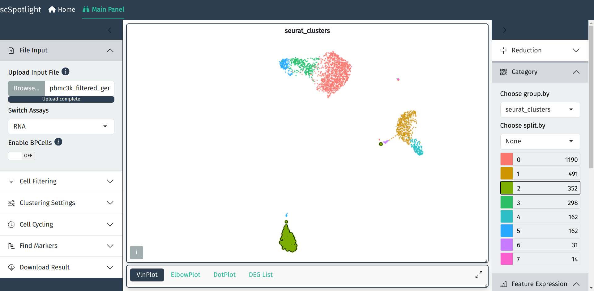

<!-- README.md is generated from README.Rmd. Please edit that file -->

```{r, include = FALSE}
knitr::opts_chunk$set(
  collapse = TRUE,
  comment = "#>",
  fig.path = "man/figures/README-",
  out.width = "100%"
)
```

# scSpotlight <a href="https://obenno.github.io/scSpotlight/"></a>

<!-- badges: start -->
[](https://obenno.r-universe.dev/scSpotlight)
<!-- badges: end -->

The goal of scSpotlight is to simplify your single cell analysis and easily
annotate your dataset with curated cell type markers. `scSpotlight` is built on
[shiny](https://shiny.posit.co/), [Seurat](https://satijalab.org/seurat/) 
and [regl-scatterplot](https://github.com/flekschas/regl-scatterplot). 
Please refer to the documentation website for detailed instructions:

- https://obenno.github.io/scSpotlight/
- https://scspotlight.netlify.app/ (EN, CN)
 

```{r, echo=FALSE, out.width="80%"}

```

## Installation

You can install the development version of scSpotlight from
[R-universe](https://r-universe.dev/) with:

``` r
install.packages(
  "scSpotlight",
  repos = c(
    "https://obenno.r-universe.dev",
    "https://satijalab.r-universe.dev",
    "https://bnprks.r-universe.dev",
    "https://cloud.r-project.org"
  )
)
```

You can also install the development version from [GitHub](https://github.com/) with:

``` r
# install.packages("devtools")
devtools::install_github("obenno/scSpotlight")
```

or a much faster installation with `pak`:

``` r
# install.packages("pak")
pak::pkg_install("obenno/scSpotlight")
```

After installation, start the app from any R session; a source checkout is not required:

``` r
scSpotlight::run_app()
scSpotlight::run_app(runningMode = "explore")
```

## Development and CI environment

- `DESCRIPTION` is the source of truth for installed-package runtime dependencies.
- `pixi.toml` is the source of truth for source-checkout development, CI, JavaScript builds, and Docker builds.
- Pixi is not required to run an already installed `scSpotlight` R package.
- The repo no longer uses `renv`; contributor setup is managed through Pixi plus `pak` fallbacks.
- `pixi run ...` commands materialize the checkout environment automatically, so `pixi install` is optional unless you want to prefetch the environment without running a task.
- Run `pixi run setup` from the repository root to install conda-first R dependencies, install `pak` fallbacks for missing required packages, install `scSpotlight`, and install JavaScript dependencies.
- Run `pixi run setup-r` when you only need to bootstrap R dependencies and install the local R package without JavaScript dependencies.
- `BPCells >= 0.3.1` is a required runtime dependency and is installed by `pixi run setup` via the fallback R package bootstrap.
- `rhdf5` is a required runtime dependency for full `.h5ad` import/export support and is installed by `pixi run setup`.
- Run `pixi run install-optional-packages` when you want optional performance support via `presto`. It uses `pak`, with `presto` sourced from `immunogenomics/presto`.
- Run `pixi run install-optional-llm` to opt into the Suggested `ellmer`, `later`, and `shinychat` packages used by the disabled-by-default LLM assistant. Verify that profile with `pixi run check-optional-llm` and exercise its focused tests with `pixi run test-llm`. Normal setup and runtime do not install or require this profile.
- Run `pixi run doctor-env` to verify `scSpotlight` is installed, `.libPaths()` points to Pixi, and no required package is missing.
- Run `pixi run run-app` to start the app in Analysis Mode.
- Run `pixi run run-app-explore` to start the app in Explore Mode.
- Commit `pixi.toml` and `pixi.lock`; do not commit `.pixi/`.

### R and RStudio with pixi

- `pixi` manages the R runtime and package libraries for this repo across Linux, macOS, and Windows.
- Use `pixi run R` or launch RStudio from a Pixi-activated shell so the IDE inherits the Pixi-managed `R` and library paths.
- The `bootstrap-r` task clears conflicting library and toolchain environment variables inside R, so `pixi run setup` works on native Windows as well as Unix shells.
- `pixi run setup` installs the BPCells-backed runtime used by both Analysis Mode and Explore Mode.

### Source checkout quickstart

```bash
# install pixi once: https://pixi.prefix.dev/latest/
pixi run setup
pixi run doctor-env
pixi run run-app
```

For Explore Mode instead of Analysis Mode:

```bash
pixi run setup
pixi run doctor-env
pixi run run-app-explore
```

### Pixi commands

- `pixi install` - prefetch/materialize the lockfile environment without running a task
- `pixi run setup-r` - install required R fallbacks and install the local R package
- `pixi run setup` - run the full app bootstrap: use Pixi-native dependencies where available, fall back to `pak::pkg_install()` for missing R packages, install JavaScript dependencies, and install the local package
- `pixi run setup-ci` - perform the locked CI bootstrap with `npm ci`
- `pixi run setup-js` - install only locked JavaScript dependencies with `npm ci`
- `pixi run install-optional-llm` - install the opt-in LLM Suggested packages
- `pixi run check-optional-llm` - fail unless the opt-in LLM profile is usable
- `pixi run dev` - start the Vite development server
- `pixi run build-js` - build the frontend bundle
- `pixi run test-js` - run frontend tests once
- `pixi run test-r` - run the R testthat suite
- `pixi run test-llm` - run the focused LLM contract tests
- `pixi run r-check` - build the source tarball, unpack that exact artifact for source-contract reads, and run `R CMD check` without checkout fallbacks
- `pixi run build-pkgdown` - build the pkgdown site
- `pixi run run-app` - launch the source-checkout app in Analysis Mode
- `pixi run run-app-analysis` - explicitly launch the source-checkout app in Analysis Mode
- `pixi run run-app-explore` - launch the source-checkout app in Explore Mode

### Pull request quality checks

Pull requests targeting `dev` run `.github/workflows/pr-quality.yaml`. It has separate gates for R tests plus the built-source package check, the opt-in LLM dependency profile and browser output-safety regression, JavaScript tests plus the production build, and the Playwright Analysis Mode scenario. The JavaScript gate fails if rebuilding changes checked-in `inst/app/www/index.js` or `inst/app/www/index.js.map`. This workflow has read-only repository permissions and performs no deployment. The existing `pkgdown` workflow remains the only workflow that deploys the documentation site.

### Representative benchmark evidence

The representative benchmark input is the CellxGene artifact `aa6ebee3-68cc-41b4-80b2-5ef5c3317e14.h5ad`: 9,663,215,939 bytes with MD5 `7933979b0faf179ce2674be6e4baed81`. Place it at the default benchmark source location under `${SCSPOTLIGHT_TEMP_ROOT:-${TMPDIR:-/tmp}/scspotlight-benchmarks}` or set `SCSPOTLIGHT_REAL_H5AD_FILE` to an existing copy, then run from a clean checkout:

``` bash
pixi run benchmark-real-h5ad
```

Benchmark schema version 2 records the exact git SHA, clean-worktree state, Pixi/Node/npm/R versions, key R package versions, machine details, browser version, and MD5 hashes for `pixi.toml`, `pixi.lock`, and `package-lock.json`. Validate a retained result against the current clean checkout and active environment with:

``` bash
SCSPOTLIGHT_BENCHMARK_EVIDENCE_FILE=/path/to/results.json \
  pixi run check-benchmark-evidence
```

The checker exits nonzero for a different SHA, a dirty checkout, changed locks, runtime versions or host environment, a nonrepresentative workload, missing browser metrics, missing named RSS gates, or a failed acceptance gate. `benchmarks/evidence/real-h5ad-2026-08-10.json` preserves the raw August 10, 2026 run as historical evidence; it is intentionally rejected as current release evidence and its performance values have not been rewritten.

## Docker

The Docker image uses Pixi during the build to create a locked production R environment, but the final image runs the installed R package directly with `Rscript`.

To build the image locally:

```bash
docker build -t scspotlight .
```

To run the app on `port:8081`:

```bash
docker run -p 8081:8081 scspotlight
```

To pull the latest image from the command line

```
docker pull registry-intl.cn-hangzhou.aliyuncs.com/thunderbio/scspotlight:0.0.3
```

To run the app on `port:8081`, please use the command below:

```
docker run -p 8081:8081 registry-intl.cn-hangzhou.aliyuncs.com/thunderbio/scspotlight:0.0.3
```
